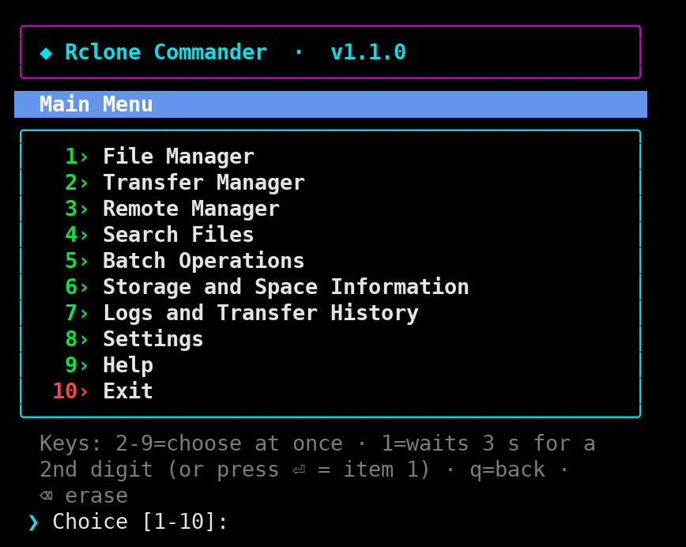
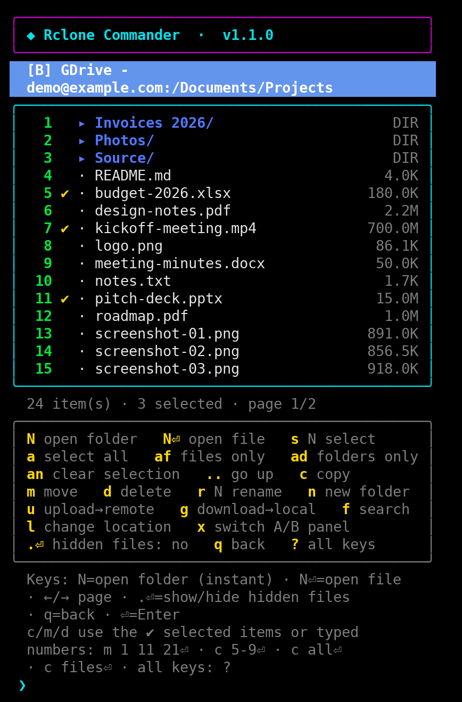
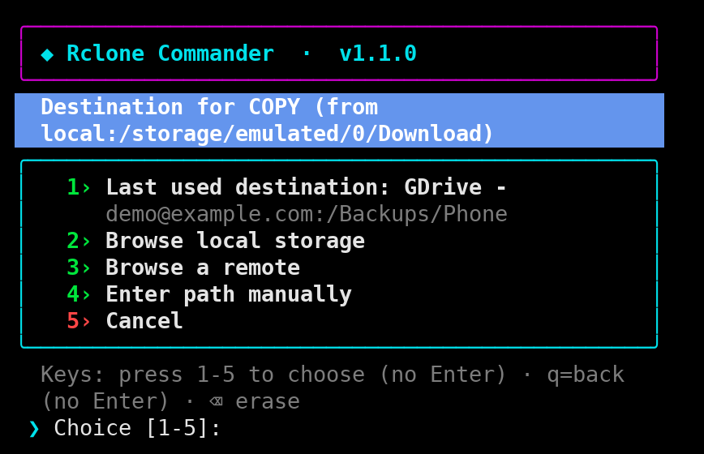
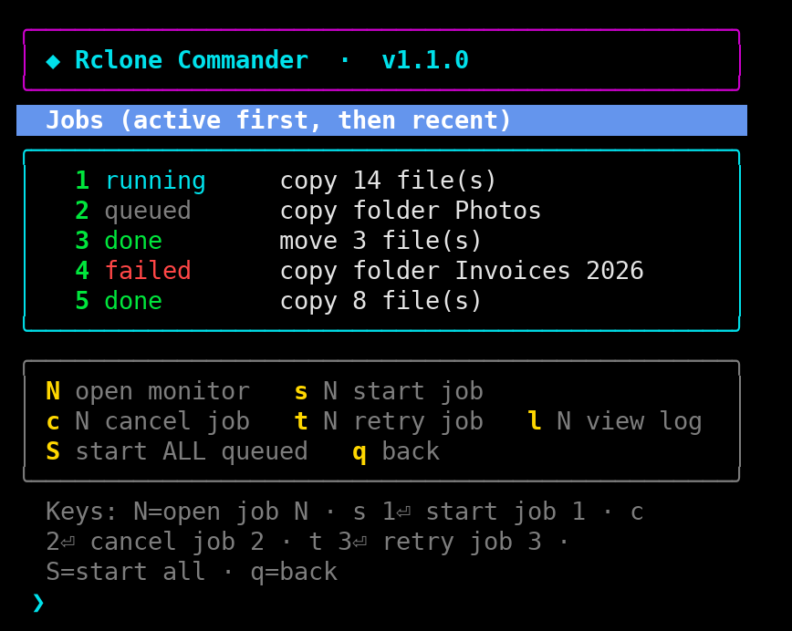
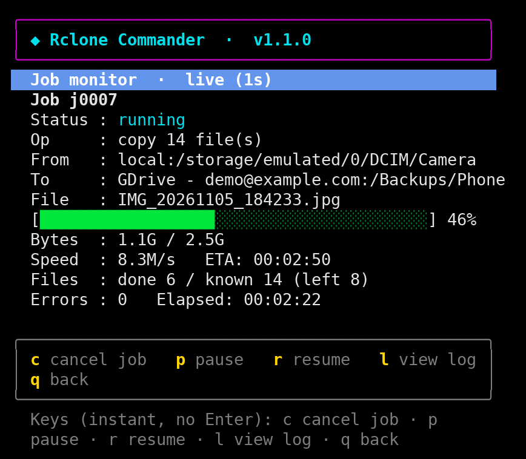
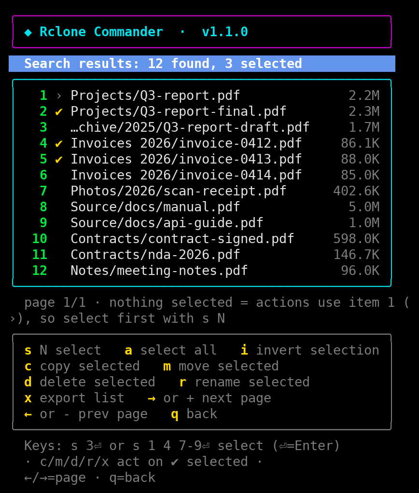
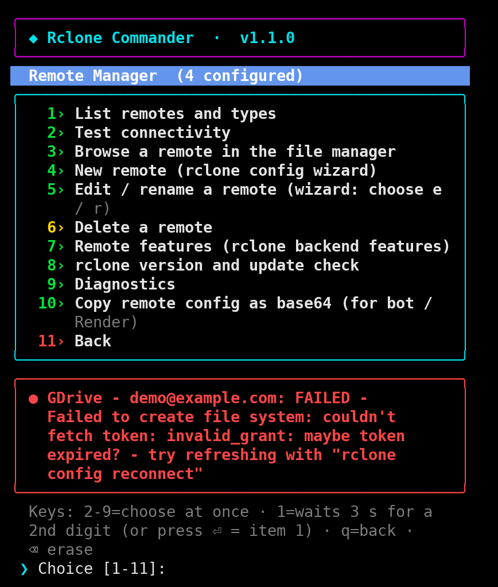
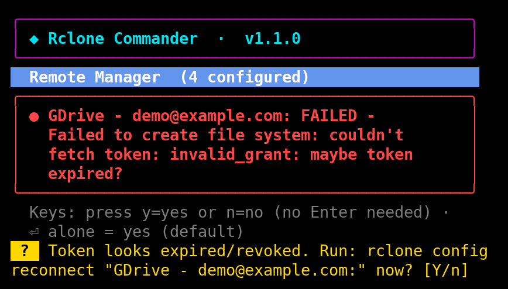
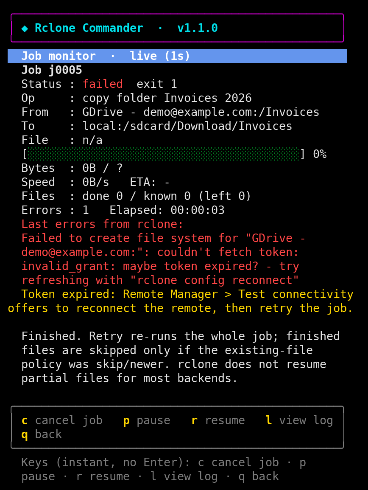
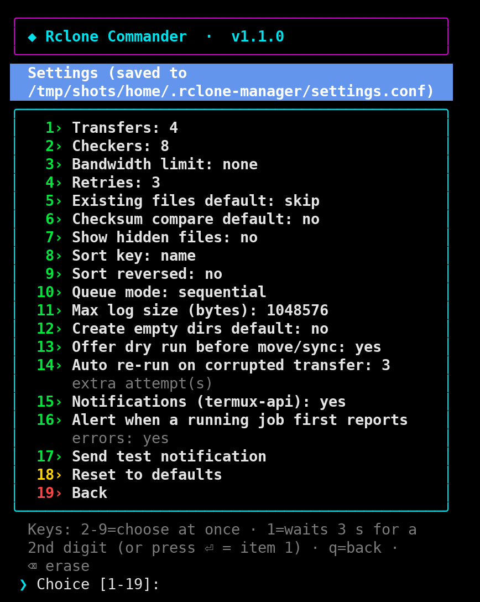

# Rclone Commander

An interactive, numbered-menu file manager and transfer manager for [rclone](https://rclone.org), built for **Termux** on Android. It is a single Bash script (`rclone.sh`) that lets you browse local storage and cloud remotes side by side, queue copy/move/sync jobs that keep running in the background, search, and run batch tools, all from a phone-friendly terminal UI.

- Press a number to choose from a menu. No Enter needed in most places.
- Browse local storage and any configured rclone remote with the same file manager.
- Transfers run as detached background jobs, so they survive closing the UI.
- Safe defaults: copy (not sync), skip existing files, dry run offered before move/sync, typed confirmation for destructive actions.

> Not affiliated with the rclone project. This script only drives the `rclone` command-line tool.

## Screenshots

<table>
<tr>
<td width="50%" align="center"><br><b>Main menu</b></td>
<td width="50%" align="center"><br><b>File manager</b></td>
</tr>
<tr>
<td width="50%" align="center"><br><b>Destination picker (remembers the last one)</b></td>
<td width="50%" align="center"><br><b>Transfer manager</b></td>
</tr>
<tr>
<td width="50%" align="center"><br><b>Live job monitor</b></td>
<td width="50%" align="center"><br><b>Search results</b></td>
</tr>
<tr>
<td width="50%" align="center"><br><b>Expired token detected</b></td>
<td width="50%" align="center"><br><b>One-key reconnect offer</b></td>
</tr>
<tr>
<td width="50%" align="center"><br><b>Failed job with a hint</b></td>
<td width="50%" align="center"><br><b>Settings</b></td>
</tr>
</table>

<sub>Demo data only (a made-up account and files). Drawn at 52 columns, a typical phone terminal width.</sub>

## Features

### File Manager
- Two independent panels (A and B), one shown at a time; switch with `x`.
- Storage selection screen: internal shared storage, SD card / external storage, Termux home, and every rclone remote.
- Copy, move, delete, rename, new folder, upload (local to remote), download (remote to local), folder size, details, preview, copy path.
- Destination picker for every transfer: last used destination, browse local storage, browse a remote, or type a path.
- Selection tools: select by number or range (`s 1 4 7-9`), select all (`a`), files only (`af`), folders only (`ad`), clear (`an`), invert (`i`), select by name pattern (`e`).
- One-step shortcuts such as `c all`, `c files`, `m dirs`.
- Sorting by name, size or time; show/hide hidden files with `.` then Enter.
- Press `?` inside the file manager for the full key list.

### Transfer Manager
- Copy, move or sync a whole directory tree (panel A to a chosen destination).
- Job queue with monitor, cancel, pause/resume, retry and per-job logs.
- Sequential or concurrent queue mode, bandwidth limit, transfers/checkers, retries, checksum compare.
- Optional wake lock (via Termux:API) to keep the CPU awake during long transfers.

### Remote Manager
- List remotes, test connectivity, browse a remote, create/edit/rename/delete remotes through the rclone config wizard.
- Remote features, rclone version and update check, diagnostics.
- Export a remote's config as base64 (see the security note below).

### Search
- Recursive search by name, extension, size range, and age, plus include/exclude globs.
- Act on results: copy, move, delete, rename, or export the list.

### Batch Operations
- Generate a manifest (size, modified time, path) of any location.
- Compare two directories, or verify copied files, optionally with a byte-for-byte check.
- Find duplicate candidates (same size and checksum, same size only, same name). Report only; nothing is deleted.
- Folder sizes, largest first, with percentages. Ctrl-C stops early and shows what was measured.
- Every location prompt offers Panel A, Panel B, **Browse folders (file manager)** or typing a path.

### Exports
Reports (manifest, duplicates, folder sizes, search export) are saved to `~/.rclone-manager/exports`. After saving, the script offers to copy the file to your phone's Download folder or any local folder you browse to. If you accept, it verifies the copy is identical and then removes the original from `exports`.

### Other
- Storage and space information, transfer history, application log, settings (saved between runs).
- Built-in help screen.

## Requirements

| | |
|---|---|
| Required | `bash` 4.4 or newer, `rclone`, `jq`, `coreutils`, `findutils` |
| Optional | `ncurses-utils`, `less`, `termux-api` (notifications, wake lock, clipboard), `ffprobe` / `mediainfo` (previews) |

On first run the script checks for the required tools and offers to install the missing ones with `pkg`.

## Installation (Termux)

```bash
# 1. Install dependencies
pkg update
pkg install rclone jq coreutils findutils ncurses-utils less termux-api

# 2. Give Termux access to your phone storage (once)
termux-setup-storage

# 3. Get the script
git clone https://github.com/AARENKAY/rclone-manager.git
cd rclone-manager
chmod +x rclone.sh

# 4. Run it
./rclone.sh
```

Optional shortcut:

```bash
echo "alias rc='$PWD/rclone.sh'" >> ~/.bashrc
```

For notifications and the wake lock, also install the **Termux:API** app (from the same source as Termux, for example F-Droid) and allow its notifications.

### Setting up a remote

If you have no remotes yet, open **Remote Manager > New remote** inside the script, which launches the standard `rclone config` wizard. An existing `rclone.conf` also works.

## Usage

```text
./rclone.sh            start the interface
./rclone.sh --help     show usage
./rclone.sh --version  print the version
```

### Main menu

1. File Manager
2. Transfer Manager
3. Remote Manager
4. Search Files
5. Batch Operations
6. Storage and Space Information
7. Logs and Transfer History
8. Settings
9. Help
10. Exit

### Quick key reference (file manager)

| Key | Action |
|---|---|
| `N` | Open folder number N (instant). A file number needs Enter and shows its details |
| `..` | Go up one folder |
| `q` | Go back one level |
| `s N`, `s 1 4 7-9` | Select items |
| `a`, `af`, `ad`, `an` | Select all, files only, folders only, clear |
| `c`, `m`, `d` | Copy, move, delete the selected items (or typed numbers: `c 5-9`) |
| `c all`, `c files`, `m dirs` | Select and act in one step |
| `r N`, `n` | Rename item N, new folder |
| `u`, `g` | Upload (local to remote), download (remote to local) |
| `f`, `w` | Search, jobs |
| `l`, `:` | Change location, jump to a path |
| `x` | Switch between panel A and B |
| `.` then Enter | Show or hide hidden files |
| `?` | Full key list |

## Safety notes

- The default operation is **copy** with "skip existing".
- **Sync** deletes extra files at the destination and requires you to type the word `SYNC`.
- **Move** removes source files only after rclone reports them transferred. A dry run is offered first.
- Deleting a folder is recursive and requires typing `DELETE`. Local deletes are permanent; remote deletes may go to the provider's trash depending on the backend.
- Without a hash that both backends support, rclone compares sizes only. Use the byte-for-byte option in Compare/Verify when you need certainty. It downloads both sides, so it is slow and uses data.
- Duplicate detection only reports candidates. Confirm before deleting anything.
- rclone generally does not resume a half-copied file; an interrupted file restarts on retry. With "skip existing" or "newer", already finished files are skipped.
- Android may still kill Termux in the background. Use the wake lock and disable battery optimization for Termux for long transfers.
- The script runs without root, avoids `eval`, builds commands from arrays and uses NUL-safe listings.

### Security: remote config export

**Remote Manager > Copy remote config as base64** puts your rclone configuration, which can contain access tokens and obscured passwords, on the clipboard. Treat it like a password. Do not paste it into public places or commit it to a repository.

## Data and files

Everything lives under `~/.rclone-manager` (override with the `RCLONE_MANAGER_HOME` environment variable):

```text
~/.rclone-manager/
├── settings.conf      saved settings
├── jobs/              queued, running and paused jobs
├── history/           finished jobs
├── logs/              application log
├── exports/           reports saved by Batch Operations and Search
├── history.tsv        transfer history
└── last_dest          last used transfer destination
```

The directory is created with owner-only permissions.

## Troubleshooting

| Problem | Fix |
|---|---|
| "Internal Shared Storage is not available" | Run `termux-setup-storage` and allow storage access in Android settings |
| SD card not accessible | Android usually limits Termux to its app-specific folder on the card. After `termux-setup-storage` it appears as `~/storage/external-N` |
| Remote listing fails with an auth error | The script offers to reconnect the remote. You can also edit it in Remote Manager |
| Hidden folders not visible | Type `.` and press Enter to toggle hidden files |
| No notifications | Install Termux:API and allow its notifications; test from Settings |
| `Bash >= 4.4 is required` | Run `pkg upgrade bash` |

## Compatibility

Developed and tested for Termux on Android. It may run on other Linux systems with Bash 4.4+, rclone and jq, but the storage selection screen and several features assume Termux paths and tools.

## Contributing

Issues and pull requests are welcome. Please run `bash -n rclone.sh` (and `shellcheck rclone.sh` if you have it) before submitting.

## License

Released under the [MIT License](LICENSE).

## Acknowledgements

Built on top of [rclone](https://rclone.org) and [jq](https://jqlang.github.io/jq/).
